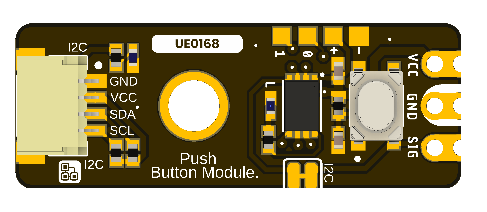

# DevLab I2C Push Button Module

The DevLab I2C Push Button Module is an I2C push button input module in the UNIT Electronics DevLab family.

  
  
<em>DevLab I2C Push Button Module</em>

### Quick Setup

## Overview

| Feature | Description |
|---|---|
| Product | DevLab I2C Push Button Module |
| MPN | UE0168 |
| Interface | I2C |
| Available visuals | Product-specific top and bottom board views |
| Factory I2C Address | `0x30` (7-bit) |
| DDP Device ID | `0x0110` |

## Applications

- Single-button user input over I2C.
- Control-panel and interaction prototypes.
- I2C input integration experiments.

## Resources

- [Schematic diagram](hardware/unit_sch_v_1_0_0_ue0168_devlab_i2c_push_button_module.pdf)
- [Hardware files and board views](hardware/README.md)
- [Product reference source](tools/product-reference/README.md)
- [Generic I2C scanner examples](software/README.md)
- [Controller firmware repository](https://github.com/UNIT-Electronics-Labs/unit_firmware_i2c_push_button_module)
- [Arduino support library](https://github.com/UNIT-Electronics-MX/unit_devlab_button_library)

The [UE0168 Rev 1.0.0 schematic](hardware/unit_sch_v_1_0_0_ue0168_devlab_i2c_push_button_module.pdf) is available. Confirm it matches the physical board before using its signal or power connections.

## 📝 License

All hardware and documentation in this project are licensed under the **MIT License**.
See the [repository license](LICENSE) for details.
