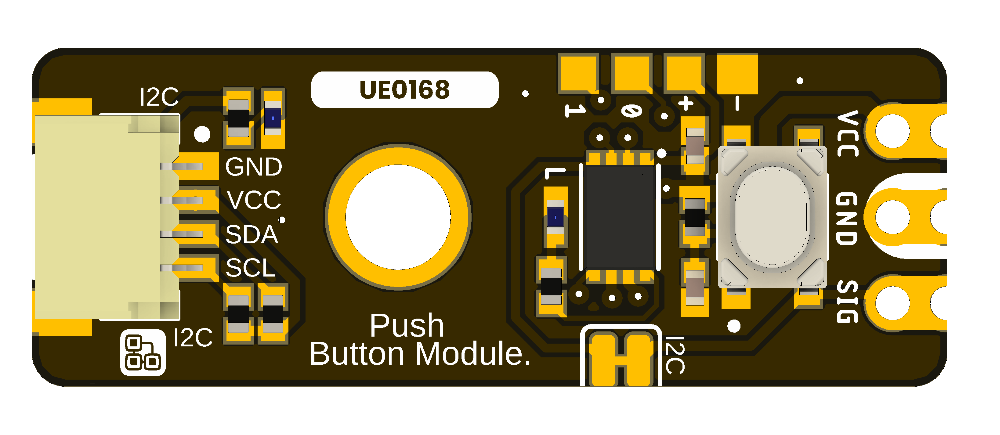
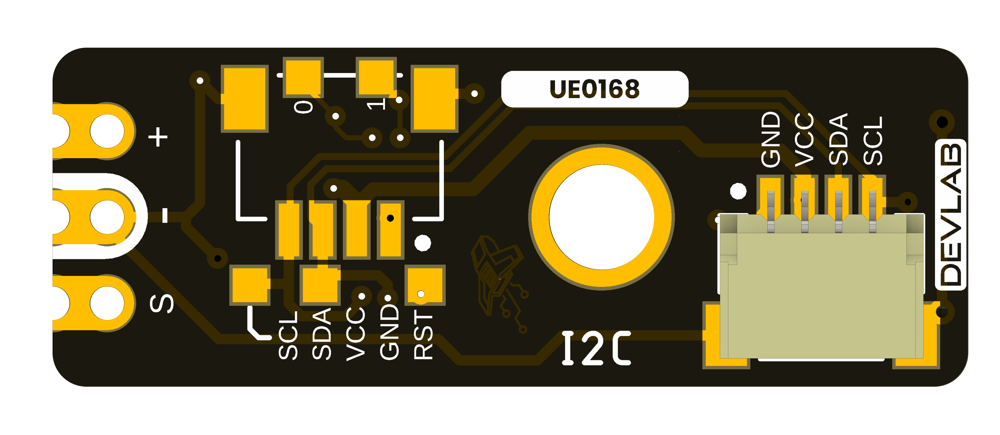

# DevLab I2C Push Button Module Hardware

## Hardware Scope

This page records the available hardware files for **DevLab I2C Push Button Module**. Values not supported by a product-specific drawing or schematic remain unspecified.

| Field | Value |
|---|---|
| MPN | UE0168 |

## Power Tree

A dedicated board-level power-tree drawing is not included in the available product-specific files.

## Block Diagram

A dedicated functional block diagram is not included in the available product-specific files.

## Naming Rules

- Product name: **DevLab I2C Push Button Module**.
- Product family: **UNIT DevLab ecosystem**.
- Existing source filenames retain their published names and revisions.
- Generated Product Reference: `unit_product_reference_v_1_1_0_ue0168_devlab_i2c_push_button_module.pdf`.

## Hardware

A product-specific electrical schematic is not included in the available files.

## Pinout

- [English pinout](./unit_pinout_v_1_0_ue0168_i2c_push_button_module_en.pdf)
- [Spanish pinout](./unit_pinout_v_1_0_ue0168_i2c_push_button_module_es.pdf)

Board renders show the supplied layout. Confirm electrical limits, connector
orientation, and mechanical tolerances against product-specific drawings before
using the board in a final assembly.

## Dimensions

- [Board dimensions](resources/unit_dimensions_v_1_0_ue0168_i2c_push_button_module.png)
- [STEP model](mechanics/unit_3d_v_1_0_ue0168_i2c_push_button_module.step)

## Topology

- [Board topology](resources/unit_topology_v_1_0_ue0168_i2c_push_button_module.png)

## Pin & Connector Layout

Use the product-specific pinout above for connector labels and positions. Cable orientation and mechanical tolerances require verification against the physical board.

## Functional Description

The DevLab I2C Push Button Module is an I2C push button input module in the UNIT Electronics DevLab family.

## Applications

- Single-button user input over I2C.
- Control-panel and interaction prototypes.
- I2C input integration experiments.

## References

- [Product Reference](../docs/hardware/unit_product_reference_v_1_1_0_ue0168_devlab_i2c_push_button_module.pdf)
- [Product Reference source](../tools/product-reference/README.md)
- [English pinout](./unit_pinout_v_1_0_ue0168_i2c_push_button_module_en.pdf)
- [Spanish pinout](./unit_pinout_v_1_0_ue0168_i2c_push_button_module_es.pdf)
