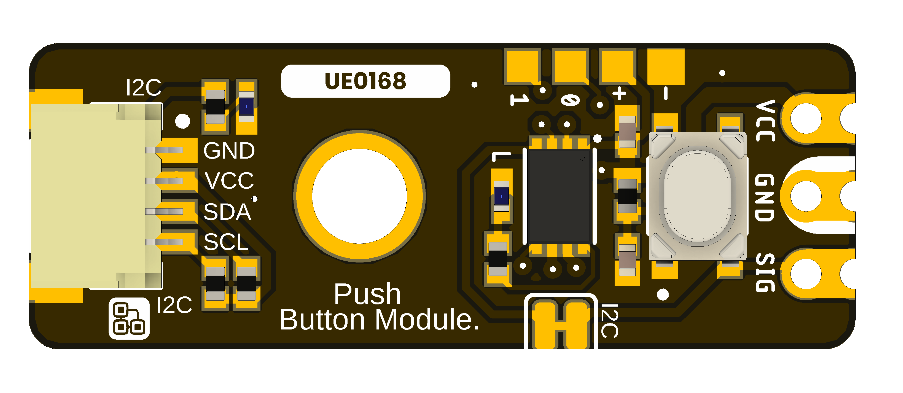
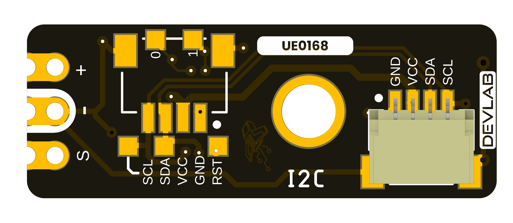

## **1 The Board**

### **1.1 Board Identification** {.section-page}

| Item | Identification |
|---|---|
| Product | DevLab I2C Push Button Module |
| Manufacturer Part Number (MPN) | UE0168 |
| Function | Push button input |

### **1.2 Board Views** {.section-page}

The following views come from the selected UE0168 source package. They show component placement and board orientation; use a dimensioned drawing for mechanical tolerances.

{width=4.5in}

{width=4.5in}
